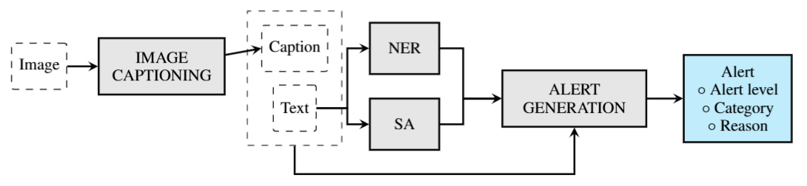

# ALARM: Alert Language-Aware Reasoning Model

Multimodal NLP and deep learning project for news-risk detection. The system combines article text, article images, named entity recognition, sentiment analysis, and a fine-tuned causal language model to produce a structured alert decision in JSON.

The accompanying paper is available at [`docs/ALARM_Paper.pdf`](docs/ALARM_Paper.pdf).



## Overview

The repository currently contains:

- reusable Python utilities in [`src/utils/`](src/utils)
- neural model definitions in [`src/Models/`](src/Models)
- research and evaluation notebooks in [`src/`](src)
- trained checkpoints in [`models/`](models)
- benchmark data and example assets in [`data/`](data)
- saved evaluation outputs in [`results/`](results)

The main runnable pipeline is [`src/utils/pipeline.py`](src/utils/pipeline.py).

## Output

The pipeline predicts a JSON alert object with these fields:

- `is_alert`
- `alert_level`
- `category`
- `reason`

The final decision is built from:

1. article text
2. article image caption
3. extracted named entities
4. article sentiment

## Current Repository Structure

```text
.
├── data/
│   ├── architecture.png
│   ├── alert_finetuning_full_benchmark.csv
│   ├── articles_expert_benchmark.csv
│   ├── articles_expert_benchmark_with_alerts.csv
│   ├── articles_expert_benchmark_with_expert_scores.csv
│   ├── expert_images/
│   └── golden_fine_tuning_alerts.csv
├── docs/
│   └── ALARM_Paper.pdf
├── models/
│   ├── ner_models/best_ner_model.pth
│   └── sa_models/ConvBiLSTM_v2.0.0_12-04-2026.pt
├── src/
│   ├── Models/
│   │   ├── BiLSTM_CRF.py
│   │   └── conv_bi_lstm.py
│   ├── utils/
│   │   ├── Full_Dataset.py
│   │   ├── alert_functions.py
│   │   ├── finetuning_functions.py
│   │   ├── ner_functions.py
│   │   ├── pipeline.py
│   │   ├── sa_functions.py
│   │   ├── utils.py
│   │   └── visual_news_processing.py
│   ├── Alert_systems.ipynb
│   ├── Example_Notebook.ipynb
│   ├── Expert_Benchmark.ipynb
│   ├── Image_Captioning.ipynb
│   ├── Named_Entity_Recognition.ipynb
│   └── Sentiment_Analysis.ipynb
├── pyproject.toml
├── requirements.txt
└── uv.lock
```

## Main Components

### Sentiment Analysis

- Model definition: [`src/Models/conv_bi_lstm.py`](src/Models/conv_bi_lstm.py)
- Inference utilities: [`src/utils/sa_functions.py`](src/utils/sa_functions.py)
- Notebook: [`src/Sentiment_Analysis.ipynb`](src/Sentiment_Analysis.ipynb)
- Checkpoint used by the pipeline: `models/sa_models/ConvBiLSTM_v2.0.0_12-04-2026.pt`

The sentiment classifier returns:

- `negative`
- `positive`

At runtime, the sentiment module also downloads Google News Word2Vec embeddings through `gdown` if they are not already available locally.

### Named Entity Recognition

- Model definition: [`src/Models/BiLSTM_CRF.py`](src/Models/BiLSTM_CRF.py)
- Utilities: [`src/utils/ner_functions.py`](src/utils/ner_functions.py)
- Notebook: [`src/Named_Entity_Recognition.ipynb`](src/Named_Entity_Recognition.ipynb)
- Checkpoint used by the pipeline: `models/ner_models/best_ner_model.pth`

The NER pipeline expects CoNLL-style resources in `data/`, including:

- `data/eng.train`
- `data/eng.testa`
- `data/eng.testb`
- `data/glove.6B.100d.txt`

Those files are required only when running the NER stage instead of supplying `--ner` manually.

### Image Captioning

- Integrated in [`src/utils/pipeline.py`](src/utils/pipeline.py)
- Exploratory notebook: [`src/Image_Captioning.ipynb`](src/Image_Captioning.ipynb)
- Model used: `Salesforce/blip-image-captioning-base`

If you already have captions, pass them with `--image-caption` to skip BLIP inference.

### Alert Classification

- Fine-tuning and generation helpers: [`src/utils/finetuning_functions.py`](src/utils/finetuning_functions.py)
- Benchmark helpers: [`src/utils/alert_functions.py`](src/utils/alert_functions.py)
- Notebook: [`src/Alert_systems.ipynb`](src/Alert_systems.ipynb)

The pipeline looks for a local merged alert model in `models/alert_finetuned_merged/`. If that directory is missing or incomplete, it tries to download the model from Hugging Face:

- `beaotero05/qwen2-Alarm-json`

Expected alert categories:

- `brand_safety`
- `legal_compliance`
- `operational_risk`
- `financial_market`
- `geopolitical`
- `esg_controversy`
- `executive_risk`
- `reputation_risk`

## Installation

The project now includes both `requirements.txt` and a `pyproject.toml` + `uv.lock` setup.

### Option 1: `uv` recommended

```bash
uv sync
```

Run commands inside the managed environment with:

```bash
uv run python src/utils/pipeline.py --help
```

### Using `uv` end to end

If you want `uv` to manage the whole environment and keep it reproducible, this is the simplest flow:

```bash
# 1. Install the locked environment
uv sync

# 2. Confirm the Python version selected by uv
uv run python --version

# 3. Check that the main pipeline is available
uv run python src/utils/pipeline.py --help

# 4. Launch Jupyter if you want to run the notebooks
uv run jupyter lab
```

Useful `uv` commands for this repository:

- `uv sync`: install everything from `pyproject.toml` and `uv.lock`
- `uv run <command>`: run a command inside the project environment without activating anything manually
- `uv lock`: regenerate `uv.lock` after dependency changes
- `uv add <package>`: add a new dependency and update the lockfile

If you prefer an activated shell instead of prefixing every command with `uv run`, you can use:

```bash
source .venv/bin/activate
```

after `uv sync`, because `uv` creates the local `.venv` for this project.

### Option 2: `pip`

```bash
python -m venv .venv
source .venv/bin/activate
pip install -r requirements.txt
```

Python `3.11+` is required according to [`pyproject.toml`](pyproject.toml).

## Running the Pipeline

The entry point is:

```bash
python src/utils/pipeline.py --help
```

Or with `uv`:

```bash
uv run python src/utils/pipeline.py --help
```

## Training and Fine-Tuning

The training and fine-tuning workflow is documented in the notebooks and supporting utilities in `src/`. All the relevant practical steps for fine-tuning are gathered in [`src/Alert_systems.ipynb`](src/Alert_systems.ipynb), which should be treated as the main reference for that workflow.

### Retraining sentiment analysis

Use [`src/Sentiment_Analysis.ipynb`](src/Sentiment_Analysis.ipynb) to:

1. load the Sentiment140 training data
2. train the Conv-BiLSTM classifier
3. evaluate it
4. save the checkpoint into `models/sa_models/`

The pipeline expects this checkpoint name by default:

- `models/sa_models/ConvBiLSTM_v2.0.0_12-04-2026.pt`

If you save a new checkpoint with a different name, either rename it to match that expected path or update the constant in [`src/utils/pipeline.py`](src/utils/pipeline.py).

### Retraining NER

Use [`src/Named_Entity_Recognition.ipynb`](src/Named_Entity_Recognition.ipynb) together with [`src/utils/ner_functions.py`](src/utils/ner_functions.py).

That workflow:

1. loads the CoNLL-style train/dev/test splits from `data/`
2. builds vocabularies and embeddings
3. trains the BiLSTM-CNN-CRF model
4. evaluates it
5. saves the final checkpoint

The pipeline expects this checkpoint by default:

- `models/ner_models/best_ner_model.pth`

The required dataset resources for NER retraining are:

- `data/eng.train`
- `data/eng.testa`
- `data/eng.testb`
- `data/glove.6B.100d.txt`

### Building the multimodal feature dataset

If you want to regenerate the intermediate dataset used for alert-model training, use [`src/utils/Full_Dataset.py`](src/utils/Full_Dataset.py).

It reads a processed dataset JSON and writes a semicolon-separated CSV containing:

- article text
- image caption
- NER output
- sentiment output

The script entrypoint currently expects:

- input JSON at `data/data/data.json`
- output CSV at `data/clean_dataset.csv`

Run it with:

```bash
uv run python src/utils/Full_Dataset.py
```

This step is useful when you want to rebuild the feature table from raw processed examples instead of relying on the CSVs already committed in `data/`.

### Fine-tuning the alert model

The alert-model training logic lives in [`src/utils/finetuning_functions.py`](src/utils/finetuning_functions.py), but all the relevant practical steps for alert fine-tuning are gathered in [`src/Alert_systems.ipynb`](src/Alert_systems.ipynb). If you want to retrain or fine-tune the alert model, that notebook is the main place to follow.

The fine-tuning flow is:

1. prepare a CSV with the columns `article`, `image_caption`, `NER`, `SA`, and `Alert`
2. load a base instruction model, typically `Qwen/Qwen2.5-7B-Instruct`
3. format prompts and labels
4. apply QLoRA/LoRA training
5. save adapter checkpoints
6. merge adapters into a standalone model directory

The pipeline looks for the merged model here:

- `models/alert_finetuned_merged/`

So after fine-tuning, make sure the merged model is saved to that directory, or pass a custom path with `--alert-model-path`.

### Benchmarking the fine-tuned alert model

Use [`src/utils/alert_functions.py`](src/utils/alert_functions.py) and the notebook [`src/Expert_Benchmark.ipynb`](src/Expert_Benchmark.ipynb) to evaluate predictions.

The repository already includes benchmark artifacts such as:

- [`results/alert_finetuning/benchmark_base_vs_finetuned.json`](results/alert_finetuning/benchmark_base_vs_finetuned.json)
- [`data/articles_expert_benchmark_with_alerts.csv`](data/articles_expert_benchmark_with_alerts.csv)
- [`data/articles_expert_benchmark_with_expert_scores.csv`](data/articles_expert_benchmark_with_expert_scores.csv)

## End-to-End Order

If you want to run everything in the right order, this is the practical sequence for the current repository.

### Fast path: use the already trained models

1. Install the environment with `uv sync`.
2. Make sure the checkpoints in `models/ner_models/` and `models/sa_models/` exist.
3. Make sure you have an alert model locally in `models/alert_finetuned_merged/`, or allow the pipeline to download it from Hugging Face.
4. Run the inference pipeline on one article or on a batch CSV.
5. Save the JSON output with `--output`.

Unless you pass a precomputed `--ner` value, the NER stage rebuilds its vocabularies from data files that are not committed to the repository. Download them and place them in `data/` before running the example below:

- `data/eng.train`, `data/eng.testa`, `data/eng.testb`: the CoNLL-2003 English NER dataset
- `data/glove.6B.100d.txt`: GloVe 6B 100d embeddings from https://nlp.stanford.edu/projects/glove/

Example:

```bash
uv run python src/utils/pipeline.py \
  --article-path path/to/article.txt \
  --image-path path/to/image.jpg \
  --output final_result.json \
  --pretty \
  --stdout
```

### Full research path: retrain and then run final inference

1. Install everything with `uv sync`.
2. Retrain sentiment analysis in [`src/Sentiment_Analysis.ipynb`](src/Sentiment_Analysis.ipynb) and save the checkpoint into `models/sa_models/`.
3. Retrain NER in [`src/Named_Entity_Recognition.ipynb`](src/Named_Entity_Recognition.ipynb) and save the checkpoint into `models/ner_models/`.
4. Prepare or regenerate the multimodal feature CSV with [`src/utils/Full_Dataset.py`](src/utils/Full_Dataset.py) if needed.
5. Fine-tune the alert model using [`src/Alert_systems.ipynb`](src/Alert_systems.ipynb) and save the merged result into `models/alert_finetuned_merged/`.
6. Evaluate the fine-tuned model with [`src/Expert_Benchmark.ipynb`](src/Expert_Benchmark.ipynb) or with helpers from [`src/utils/alert_functions.py`](src/utils/alert_functions.py).
7. Run the final inference pipeline on your target article or dataset with [`src/utils/pipeline.py`](src/utils/pipeline.py).
8. Collect the final JSON outputs from the file passed to `--output`, or inspect the benchmark artifacts in `results/`.

### How to obtain the final results

There are two kinds of final results in this project:

- Inference results: produced by [`src/utils/pipeline.py`](src/utils/pipeline.py) and saved to the file given in `--output`
- Evaluation results: produced by the benchmark workflow and saved under [`results/`](results) and some CSVs in [`data/`](data)

For a single article, the final result is the JSON produced by:

```bash
uv run python src/utils/pipeline.py \
  --article-path path/to/article.txt \
  --image-path path/to/image.jpg \
  --output final_result.json \
  --pretty \
  --stdout
```

For benchmark-style final results, use the evaluation notebooks/utilities and then inspect:

- [`results/alert_finetuning/benchmark_base_vs_finetuned.json`](results/alert_finetuning/benchmark_base_vs_finetuned.json)
- [`data/articles_expert_benchmark_with_alerts.csv`](data/articles_expert_benchmark_with_alerts.csv)
- [`data/articles_expert_benchmark_with_expert_scores.csv`](data/articles_expert_benchmark_with_expert_scores.csv)

### Single article

Using raw article text:

```bash
python src/utils/pipeline.py \
  --article "Your news article text here" \
  --image-path path/to/image.jpg \
  --output output.json \
  --pretty \
  --stdout
```

Using an article text file:

```bash
python src/utils/pipeline.py \
  --article-path path/to/article.txt \
  --image-path path/to/image.jpg \
  --output output.json \
  --pretty
```

Skipping some stages with precomputed values:

```bash
python src/utils/pipeline.py \
  --article-path path/to/article.txt \
  --image-caption "precomputed caption" \
  --ner "precomputed ner output" \
  --sa "negative" \
  --output output.json \
  --pretty \
  --stdout
```

### Batch mode

Batch mode reads a CSV and maps its columns to pipeline inputs.

Example with article text in a column:

```bash
python src/utils/pipeline.py \
  --batch-csv data/my_batch.csv \
  --batch-article-column article \
  --batch-image-column image_path \
  --batch-image-caption-column image_caption \
  --batch-ner-column NER \
  --batch-sa-column SA \
  --batch-id-column id \
  --batch-csv-delimiter ';' \
  --output batch_output.json \
  --pretty
```

If your CSV contains article file paths instead of raw text, use `--batch-article-path-column`.

### Alert model override

```bash
python src/utils/pipeline.py \
  --article-path path/to/article.txt \
  --image-path path/to/image.jpg \
  --alert-model-path models/alert_finetuned_merged \
  --output output.json \
  --pretty
```

## CLI Notes

Important details from the current implementation in [`src/utils/pipeline.py`](src/utils/pipeline.py):

- `--output` writes the JSON result to disk.
- JSON is printed only if you pass `--stdout`.
- `--pretty` controls indentation only.
- `--debug` enables extra logs while models are being loaded and run.
- Single mode requires either `--article` or `--article-path`.
- Batch mode requires `--batch-csv` plus either `--batch-article-column` or `--batch-article-path-column`.

## Example Output

Single-item inference returns a structure like:

```json
{
  "mode": "single",
  "item": {
    "article": "...",
    "image_path": "...",
    "image_caption": "...",
    "ner_normalized": "...",
    "sentiment": "negative",
    "final_alert": {
      "is_alert": false,
      "alert_level": null,
      "category": null,
      "reason": null,
      "source": "fine_tuned_alert_model"
    }
  }
}
```

Note: the repository currently does not include a committed `result.json` example file.

## Data and Evaluation Assets

The repository currently includes these benchmark and evaluation resources:

- [`data/golden_fine_tuning_alerts.csv`](data/golden_fine_tuning_alerts.csv)
- [`data/alert_finetuning_full_benchmark.csv`](data/alert_finetuning_full_benchmark.csv)
- [`data/articles_expert_benchmark.csv`](data/articles_expert_benchmark.csv)
- [`data/articles_expert_benchmark_with_alerts.csv`](data/articles_expert_benchmark_with_alerts.csv)
- [`data/articles_expert_benchmark_with_expert_scores.csv`](data/articles_expert_benchmark_with_expert_scores.csv)
- [`results/alert_finetuning/benchmark_base_vs_finetuned.json`](results/alert_finetuning/benchmark_base_vs_finetuned.json)

Benchmark utilities live in [`src/utils/alert_functions.py`](src/utils/alert_functions.py). They compute binary alert metrics, field-level metrics for `alert_level` and `category`, and basic latency/output-length statistics.

## Notebooks

Current notebooks in the repository:

- [`src/Alert_systems.ipynb`](src/Alert_systems.ipynb)
- [`src/Example_Notebook.ipynb`](src/Example_Notebook.ipynb)
- [`src/Expert_Benchmark.ipynb`](src/Expert_Benchmark.ipynb)
- [`src/Image_Captioning.ipynb`](src/Image_Captioning.ipynb)
- [`src/Named_Entity_Recognition.ipynb`](src/Named_Entity_Recognition.ipynb)
- [`src/Sentiment_Analysis.ipynb`](src/Sentiment_Analysis.ipynb)

## Download Note

Internet access is needed the first time you run the full workflow, because some models and assets may be downloaded from Hugging Face and Google Drive-backed sources before they are cached locally.

## Authors

- Lucía Herraiz Cano
- Álvaro Pérez Ortega
- Beatriz Otero Casanovas
- Alberto Prieto González
